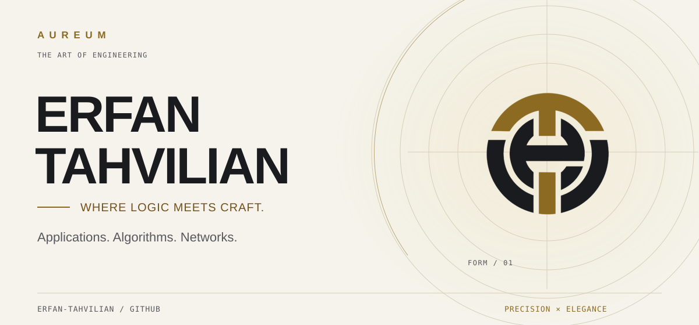
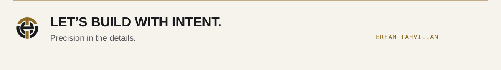

<picture>
  <source media="(prefers-color-scheme: dark) and (max-width: 640px)" srcset="assets/hero/hero-dark-mobile.svg">
  <source media="(max-width: 640px)" srcset="assets/hero/hero-light-mobile.svg">
  <source media="(prefers-color-scheme: dark)" srcset="assets/hero/hero-dark.svg">
  
</picture>

# Erfan Tahvilian

I build applications and explore the systems beneath them - from connection controls in FoxVPN to language parsing, scheduling and multipath transport. My public work pairs practical software with focused implementations of core computing ideas.

[Selected work](#selected-work) · [Engineering toolkit](#engineering-toolkit) · [GitHub activity](#github-activity) · [Connect](#connect)

## Selected work

<a href="https://github.com/erfan-tahvilian/FoxVPN">
<picture>
  <source media="(prefers-color-scheme: dark) and (max-width: 640px)" srcset="assets/projects/foxvpn-dark-mobile.svg?v=3">
  <source media="(max-width: 640px)" srcset="assets/projects/foxvpn-light-mobile.svg?v=3">
  <source media="(prefers-color-scheme: dark)" srcset="assets/projects/foxvpn-dark.svg?v=3">
  
</picture>
</a>

<a href="https://github.com/erfan-tahvilian/config-pilot">
<picture>
  <source media="(prefers-color-scheme: dark) and (max-width: 640px)" srcset="assets/projects/config-pilot-dark-mobile.svg?v=3">
  <source media="(max-width: 640px)" srcset="assets/projects/config-pilot-light-mobile.svg?v=3">
  <source media="(prefers-color-scheme: dark)" srcset="assets/projects/config-pilot-dark.svg?v=3">
  
</picture>
</a>

<a href="https://github.com/erfan-tahvilian/compiler-lexer-parser">
<picture>
  <source media="(prefers-color-scheme: dark) and (max-width: 640px)" srcset="assets/projects/compiler-dark-mobile.svg?v=3">
  <source media="(max-width: 640px)" srcset="assets/projects/compiler-light-mobile.svg?v=3">
  <source media="(prefers-color-scheme: dark)" srcset="assets/projects/compiler-dark.svg?v=3">
  
</picture>
</a>

<a href="https://github.com/erfan-tahvilian/mptcp">
<picture>
  <source media="(prefers-color-scheme: dark) and (max-width: 640px)" srcset="assets/projects/mptcp-dark-mobile.svg?v=3">
  <source media="(max-width: 640px)" srcset="assets/projects/mptcp-light-mobile.svg?v=3">
  <source media="(prefers-color-scheme: dark)" srcset="assets/projects/mptcp-dark.svg?v=3">
  
</picture>
</a>

<strong>Four more engineering studies - scheduling, optimization, cryptography and numerical methods</strong>

 

<a href="https://github.com/erfan-tahvilian/srtf-scheduler">
<picture>
  <source media="(prefers-color-scheme: dark) and (max-width: 640px)" srcset="assets/projects/scheduler-dark-mobile.svg?v=3">
  <source media="(max-width: 640px)" srcset="assets/projects/scheduler-light-mobile.svg?v=3">
  <source media="(prefers-color-scheme: dark)" srcset="assets/projects/scheduler-dark.svg?v=3">
  
</picture>
</a>

<a href="https://github.com/erfan-tahvilian/simulated-annealing-tsp">
<picture>
  <source media="(prefers-color-scheme: dark) and (max-width: 640px)" srcset="assets/projects/annealing-dark-mobile.svg?v=3">
  <source media="(max-width: 640px)" srcset="assets/projects/annealing-light-mobile.svg?v=3">
  <source media="(prefers-color-scheme: dark)" srcset="assets/projects/annealing-dark.svg?v=3">
  
</picture>
</a>

<a href="https://github.com/erfan-tahvilian/simple-des">
<picture>
  <source media="(prefers-color-scheme: dark) and (max-width: 640px)" srcset="assets/projects/des-dark-mobile.svg?v=3">
  <source media="(max-width: 640px)" srcset="assets/projects/des-light-mobile.svg?v=3">
  <source media="(prefers-color-scheme: dark)" srcset="assets/projects/des-dark.svg?v=3">
  
</picture>
</a>

<a href="https://github.com/erfan-tahvilian/bisection-root-finder">
<picture>
  <source media="(prefers-color-scheme: dark) and (max-width: 640px)" srcset="assets/projects/bisection-dark-mobile.svg?v=3">
  <source media="(max-width: 640px)" srcset="assets/projects/bisection-light-mobile.svg?v=3">
  <source media="(prefers-color-scheme: dark)" srcset="assets/projects/bisection-dark.svg?v=3">
  
</picture>
</a>

Simplified DES is an educational cipher implementation. The diagrams above illustrate project concepts; they are not benchmark results.

<picture>
  <source media="(prefers-color-scheme: dark)" srcset="assets/components/divider-dark.svg">
  
</picture>

## Engineering toolkit

| Area | Used in my public projects |
| :--- | :--- |
| Languages | C++ · JavaScript · HTML · CSS |
| Application development | Electron · Node.js · desktop interfaces |
| Systems & algorithms | Lexical analysis · parsing · CPU scheduling · simulated annealing |
| Networking & computation | ns-3 · Multipath TCP · OpenMP · numerical methods |
| Build & verification | npm scripts · CMake · command-line tooling |

## GitHub activity

Follow the code as it evolves: [public activity](https://github.com/erfan-tahvilian?tab=overview) · [all repositories](https://github.com/erfan-tahvilian?tab=repositories).

## Connect

<a href="https://erfantahvilian.cv"><picture><source media="(prefers-color-scheme: dark)" srcset="assets/components/social-portfolio-dark.svg"></picture></a> &nbsp;&nbsp;
<a href="https://www.linkedin.com/in/erfan-tahvilian"><picture><source media="(prefers-color-scheme: dark)" srcset="assets/components/social-linkedin-dark.svg"></picture></a> &nbsp;&nbsp;
<a href="https://t.me/Erfan_Thvn"><picture><source media="(prefers-color-scheme: dark)" srcset="assets/components/social-telegram-dark.svg"></picture></a> &nbsp;&nbsp;
<a href="https://github.com/erfan-tahvilian"><picture><source media="(prefers-color-scheme: dark)" srcset="assets/components/social-github-dark.svg"></picture></a>

<a href="https://github.com/erfan-tahvilian">
<picture>
  <source media="(prefers-color-scheme: dark) and (max-width: 640px)" srcset="assets/components/footer-dark-mobile.svg">
  <source media="(max-width: 640px)" srcset="assets/components/footer-light-mobile.svg">
  <source media="(prefers-color-scheme: dark)" srcset="assets/components/footer-dark.svg">
  
</picture>
</a>

